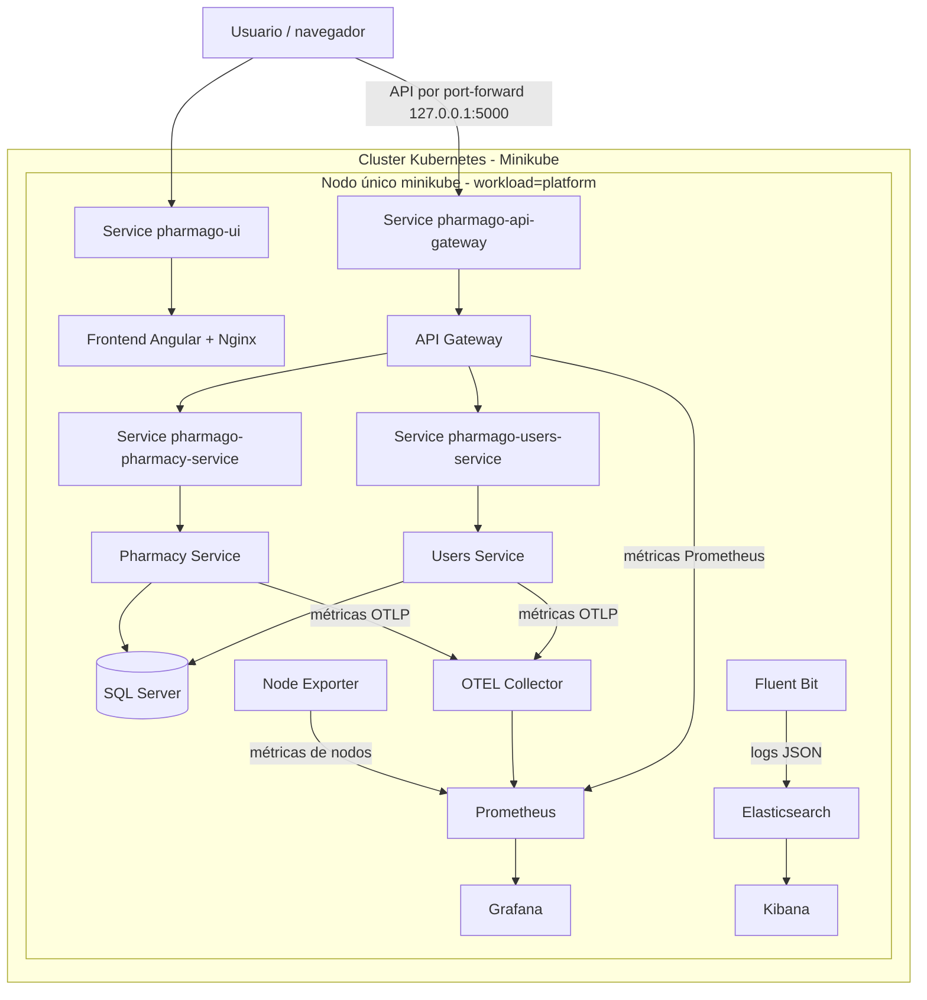

# Bosquejo del diagrama de despliegue

El siguiente diagrama representa la distribución de la plataforma en Minikube,
desplegada sobre un único nodo Kubernetes.



## Evidencia esperada

```text
Todos los componentes              -> minikube (nodo único, workload=platform)

Plataforma (required → platform):
  pharmago-db                      -> minikube
  elasticsearch/prometheus/grafana -> minikube
  otel-collector / kibana          -> minikube

Microservicios (afinidad blanda/preferred por label workload):
  pharmago-ui                  -> workload=frontend (declarativa)
  pharmago-users-service       -> workload=users (declarativa)
  pharmago-pharmacy-service    -> workload=pharmacy (declarativa)
  pharmago-api-gateway         -> workload=gateway (declarativa)

DaemonSets:
  fluent-bit / node-exporter   -> una instancia en el nodo
```

La separación de los microservicios por label `workload` es **declarativa**
(afinidad blanda, `preferredDuringSchedulingIgnoredDuringExecution`): en este
entorno de un solo nodo todos los pods comparten el nodo físico, pero los
manifiestos expresan el aislamiento por label. En un entorno productivo
multi-nodo, esa afinidad se elevaría a `required
DuringSchedulingIgnoredDuringExecution` para que cada microservicio corra en un
nodo físico distinto.

El frontend es una aplicación estática: las llamadas HTTP al API se originan en
el navegador. Por eso el frontend y el API Gateway no requieren comunicación
directa entre el contenedor Nginx y el Gateway.
