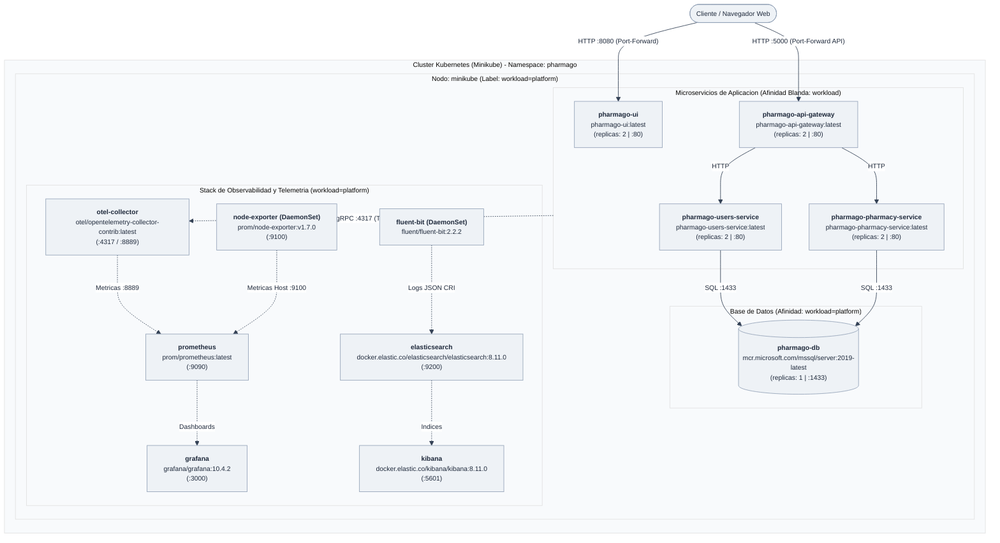

# Diagrama de Despliegue de la Plataforma

Este documento describe la arquitectura de despliegue sobre Kubernetes (Minikube de nodo único), con los microservicios, la base de datos relacional y la infraestructura de observabilidad.

## Imagen para Documentación (Tema Claro)

Para incluir en el informe académico final (Word/PDF), se generaron dos formatos listos para usar en `Implementacion K8S/Documentación/img/`:
- [diagrama-despliegue.png](file:///c:/ID/AIOps-282102-284068/Implementacion%20K8S/Documentacio%CC%81n/img/diagrama-despliegue.png) (PNG renderizado nítido con fondo claro)
- [diagrama-despliegue.svg](file:///c:/ID/AIOps-282102-284068/Implementacion%20K8S/Documentacio%CC%81n/img/diagrama-despliegue.svg) (Gráfico vectorial escalable)

---

## Diagrama Mermaid (Tema Claro Simplificado)

---

## Distribución y Afinidad de Cargas

- **Nodo de Plataforma (`workload=platform`)**:
  - `minikube` actúa como nodo único donde residen los PersistentVolumes y componentes de plataforma (`pharmago-db`, `elasticsearch`, `prometheus`, `grafana`, `otel-collector`, `kibana`).
- **Microservicios**:
  - Cada microservicio corre en pods independientes con 2 réplicas (`replicas: 2`).
  - Afinidad declarativa blanda (`preferredDuringScheduling...`) por label `workload` (`frontend`, `gateway`, `users`, `pharmacy`), preparada para elevarse a `required` en entornos multi-nodo.
- **DaemonSets**:
  - `fluent-bit` y `node-exporter` ejecutan una instancia por nodo para recolección de logs a nivel de contenedor y métricas a nivel de sistema operativo/nodo.
